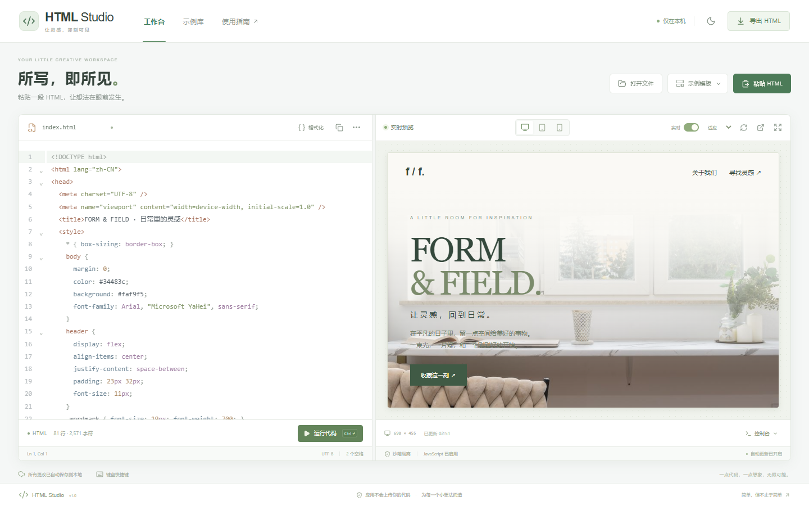

# HTML Studio

所写，即所见。一个清爽、本地优先的 HTML 实时预览工作台。

把 HTML 粘贴到编辑器，就能立刻看到渲染结果。无需账户、后端或数据库，适合验证页面、调试小组件和分享独立 HTML 文件。



## 功能

- CodeMirror 6 代码编辑器：HTML / 内联 CSS / JavaScript 高亮、自动补全、括号匹配、折叠和搜索。
- 350 毫秒防抖实时预览，也可关闭自动更新，使用按钮或快捷键手动运行。
- 桌面、768px 平板、390px 手机视图；缩放、可拖动双栏、全屏和独立窗口预览。
- Prettier 格式化，支持 HTML 中的 CSS 与 JavaScript。
- 导入 HTML / HTM / TXT、拖入文件、复制代码、导出独立 HTML。
- 浏览器本地自动保存草稿、文件名与主题；提供浅色和深色界面。
- 沙箱预览及控制台：查看日志、警告、运行错误，随时禁用 JavaScript。
- 四个内置示例：自然系品牌页、个人主页、交互计数器与 SVG 鹈鹕骑行。

## 快速启动

开发构建要求 Node.js **20.19+ 或 22.12+**，推荐 Node.js 22 LTS。

```bash
npm ci
npm run dev
```

打开终端提示的地址，默认是 `http://127.0.0.1:5178`。如果端口已被使用，Vite 会提示新的端口。

### Windows：不需要 Bash 的启动方式

Windows 的命令提示符 / PowerShell 默认不提供 `bash`，所以在这些窗口输入 `bash start.sh` 会出现“不是内部或外部命令”。无需为了启动应用另外安装 Bash。

在项目目录中双击以下文件，或在命令提示符执行：

```bat
start.cmd
```

PowerShell 中使用 `./start.cmd`。启动入口会优先使用项目 `.tools/` 下已准备的独立 Node，否则使用系统 Node；默认只监听本机。现有构建存在时不会重新安装依赖。首次从 GitHub 克隆项目，请先用 Node.js 20.19+ 或 22.12+ 执行 `npm ci` 和 `npm run build`。

成功后会打开浏览器，并显示实际地址，通常是 `http://127.0.0.1:4178`。关闭启动窗口不会停止后台服务。重复启动同一模式不会再创建一份服务。

### 停止这个项目的服务

双击或运行：

```bat
stop.cmd
```

也可以使用 `npm run stop`。停止入口只通过本机受保护的控制接口停止这个项目，不会执行“关闭全部 node.exe”之类的操作。服务信息、控制密钥与日志位于 `.runtime/`，已被 Git 忽略，且不会通过网页公开。

需要保持前台运行并通过 Ctrl+C 停止时，使用 `npm run serve`。旧版通过 Git Bash 启动的服务，可以在启动它的那个终端按 Ctrl+C。

### Git Bash / macOS / Linux

```bash
bash start.sh
```

在 Git Bash 中使用项目独立运行时开发：

```bash
export PATH="$PWD/.tools/node-v22.23.4-win-x64:$PATH"
npm run dev
```

如果 Windows 上没有符合要求的 Node，可以运行：

```bash
bash scripts/bootstrap-runtime.sh
```

脚本只从 Node.js 官方站点下载固定版本，校验 SHA-256，解压到 `.tools/`。这个目录已被 Git 忽略，不应提交到 GitHub。macOS / Linux 请使用自己安装的 Node.js LTS。

## 手机怎么用

### 方式一：同一 Wi-Fi，电脑保持开机

1. 让电脑和手机连接同一个可信 Wi-Fi。
2. 在电脑上运行 `start-lan.cmd`，或执行 `npm run start:lan`。
3. 打开窗口打印的 `Phone / same Wi-Fi` 地址，例如 `http://192.168.1.20:4178`。这里的 IP 只是示例，以你电脑打印的地址为准。
4. 手机浏览器访问该地址。手机上的 `localhost` / `127.0.0.1` 指的是手机自己，不能用来访问电脑。

Windows 防火墙如果询问权限，仅对可信的“专用网络”放行，不要为公用网络开放，也不要配置路由器公网端口映射。访客 Wi-Fi / AP 隔离、VPN、公司网络策略可能阻止手机访问，需要在自己的网络中确认。应用不会自动修改防火墙。

如果打印多个地址，请选择与手机处于同一网段的 Wi-Fi / 以太网地址；虚拟网卡、Docker 或 VPN 地址通常不能用于手机直连。

运行 `start.cmd` 可切回本机模式；切换模式会先正常停止本项目已记录的服务，再重新启动。`stop.cmd` 对两种模式都有效。

局域网 HTTP 通常不允许浏览器自动读取剪贴板。在手机上请切换到「代码」，长按编辑器选择「粘贴」；应用已经为非 HTTPS 环境提供随机标识兼容处理。电脑和手机的草稿分别保存在各自浏览器，不会自动同步。工具栏的手机图标只是响应式尺寸预览，不是网络连接开关。

### 方式二：GitHub Pages，HTTPS 随时访问

源码仓库地址不是在线应用地址。如果希望电脑关机后手机仍能使用，可手动开启 GitHub Pages：

1. 在仓库的 Settings → Pages 中，将 Source 设为 GitHub Actions。
2. 在 Actions 中选择 **Deploy Pages (manual)**，点击 Run workflow。
3. 成功后使用工作流给出的 HTTPS 地址。HTTPS 下剪贴板等能力支持更完整。

仓库：<https://github.com/liguokai444-dot/YOUR-LITTLE-CREATIVE-WORKSPACE>。
启用后地址通常为 `https://liguokai444-dot.github.io/YOUR-LITTLE-CREATIVE-WORKSPACE/`，以 GitHub 实际部署结果为准。

项目只准备了手动部署工作流，不会在普通提交时自动部署，也不会替你更改 Pages 设置。发布的是应用及示例，不是电脑或手机浏览器里的草稿。

## 特殊字符路径兼容

Vite 对路径中的 `#`、`?` 支持有限，例如父目录名为 `C#`。本项目的 `scripts/vite-task.mjs` 会在这类路径下自动建立一个临时工作镜像，只复制当前项目的公开源码、资源和已安装依赖，构建成功后把 `dist/` 带回原项目。

开发模式会同步 `src/` 和 `public/` 的改动，以保持热更新；退出时清理临时镜像。不会重命名原目录，也不会复制 `.env`、私有配置或项目内的独立 Node 运行时。第一次创建镜像可能需要几十秒。依赖发生变化后，请重新启动开发服务器。

## 构建与本地成品

```bash
npm run build
npm start
```

构建文件位于 `dist/`。`npm start` 启动项目管理的后台服务，默认只监听 `127.0.0.1`；`npm run stop` 停止它，`npm run status` 查看状态。已有构建的情况下，启动器和静态服务器也兼容 Node.js 16；但安装依赖及开发构建仍需现代 Node。

也可以执行 `npm run preview` 使用 Vite 预览。不要双击 `dist/index.html`：应通过本地 HTTP 服务打开模块化应用。

## 使用方式

1. 直接在左侧粘贴 HTML，或点击「粘贴 HTML」「打开文件」「示例模板」。
2. 使用右侧设备按钮检查响应式布局。拖动中间分隔条调整双栏宽度。
3. 点击预览下方的「控制台」查看 `console.log`、警告和脚本错误。
4. 点击「导出 HTML」保存文件。应用内置示例图片会被内联；用户代码中的其他外链资源保留原始地址，不会自动下载或打包。

文件导入大小限制为 2 MB，推荐 UTF-8 编码。相对资源地址会相对于当前应用地址解析；未导入的本机图片、脚本等文件不会自动获得访问权限。

## 快捷键

在编辑器或应用工具栏获得焦点时：

| 操作 | Windows / Linux | macOS |
| --- | --- | --- |
| 运行 | Ctrl + Enter | Command + Enter |
| 导出 HTML | Ctrl + S | Command + S |
| 打开文件 | Ctrl + O | Command + O |
| 格式化 | Ctrl + Shift + F | Command + Shift + F |
| 搜索代码 | Ctrl + F | Command + F |
| 退出全屏预览 | Esc | Esc |

## 隐私与安全边界

- 应用不会主动把编辑内容上传到服务器；草稿保存于当前浏览器的 `localStorage`。清除站点数据或更换浏览器会使草稿不可用，请及时导出重要内容。
- 预览使用 `sandbox="allow-scripts"` 的 iframe，**不启用 `allow-same-origin`**，因此预览不能读取应用 DOM、Cookie 或本地草稿存储。
- 独立窗口同样使用沙箱，并断开 `opener`。
- 沙箱不是恶意代码扫描器，也不保证终止死循环。HTML 引用的图片、脚本、字体或其他资源仍可能访问外部网络。只运行可信代码；不需要脚本时，可在预览底部关闭 JavaScript。
- 新窗口、表单、下载、浏览器弹窗等能力受到沙箱限制；完整 HTML 导出后可按浏览器正常规则运行。
- 本地服务器只发布 `dist/`，拒绝隐藏文件与目录穿越，不提供文件写入 API。
- 局域网模式是明确选择的选项，不默认开启。管理接口仅接受来自本机且携带私有控制密钥的请求；网页端不知道这个密钥。

## 项目结构

```text
html-studio/
  src/
    App.tsx                 工作台与交互状态
    index.css               界面与响应式样式
    studio/CodeEditor.tsx    编辑器主题和语言配置
    studio/preview.ts       沙箱桥接、格式化和导出工具
    studio/templates.ts     示例内容
  public/
    images/                 本地示例照片
    examples/pelican.html    独立 SVG 动画示例
  scripts/
    bootstrap-runtime.sh    Windows 独立 Node 引导
    vite-task.mjs           特殊字符路径下的构建及开发镜像
    serve-studio.mjs        本地静态服务器
    launcher.cjs            独立后台服务管理
    service-control.cjs     受保护的本机状态与停止接口
    privacy-check.mjs       暂存区 / 跟踪文件隐私检查
  tests/studio.spec.ts       浏览器交互测试
  .github/workflows/ci.yml   GitHub 构建检查
  start.sh                  本机启动入口
  start.cmd                 Windows 本机启动
  start-lan.cmd             Windows 可信 Wi-Fi 启动
  stop.cmd                  Windows 停止入口
  vite.config.mjs
  package.json
  package-lock.json
```

## 测试

```bash
npx playwright install chromium
npm run test:e2e
```

也可以使用已经安装的 Chrome：

```bash
PLAYWRIGHT_CHANNEL=chrome npm run test:e2e
```

测试覆盖实时更新、手动运行、格式化、导入导出、本地草稿、设备模式、脚本禁用及移动端。

服务控制与访问保护测试：

```bash
npm run test:service
```

## 放到 GitHub

把 **html-studio 目录本身** 作为独立仓库根目录，不要把父级工作区的其他工程或私有配置一起发布。

```bash
git init
git add .
git commit -m "Initial HTML Studio application"
git branch -M main
git remote add origin https://github.com/liguokai444-dot/YOUR-LITTLE-CREATIVE-WORKSPACE.git
git push -u origin main
```

`.gitignore` 已排除 `node_modules/`、`dist/`、`.tools/`、`.runtime/`、环境配置、日志和测试产物。不要把父级工作区、MCP 配置、个人文件或访问令牌添加到仓库。公开提交建议使用 GitHub noreply 邮箱，而不是本机真实邮箱。

提交前可执行 `npm run check:privacy` 检查暂存区，或 `node scripts/privacy-check.mjs --tracked` 检查索引内全部文件。检查只报告文件名和问题类型，不打印发现的敏感值；它不是对所有隐私信息的绝对保证，发布截图和修改过的示例仍需人工确认。

提供的 GitHub Actions 会自动执行隐私检查、构建及服务测试。Pages 仅通过另一个手动工作流部署。Vite 使用相对资源基路径，适合仓库子路径托管。

## 技术与素材

React 19、TypeScript、Vite 7、Tailwind CSS 4、CodeMirror 6、Prettier、Lucide。

示例照片来自 [Mateusz Pielech / Pexels](https://www.pexels.com/photo/armchair-at-white-desk-by-windows-in-room-20348124/)，按 [Pexels 许可](https://www.pexels.com/license/) 使用；图像权利不属于项目代码的 MIT 授权范围。

项目代码使用 MIT License，详见 `LICENSE`。
